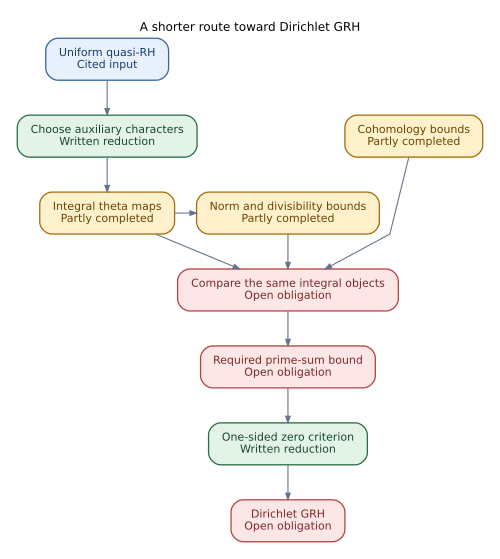
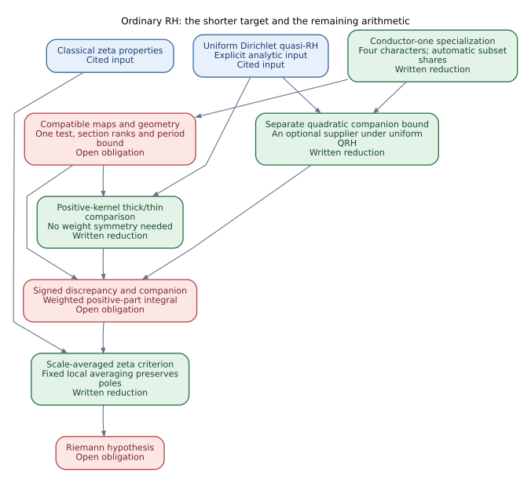

# Distilling the Generalized Riemann Hypothesis

**[Short guide](paper/guide/main.pdf)** · **[RH manuscript](paper/rh/main.pdf)** · **[Dirichlet GRH manuscript](paper/grh/main.pdf)** · **[RH proof map](blueprint/rh/proof.svg)** · **[GRH proof map](blueprint/grh/proof.svg)** · **[Shared overview](blueprint/overview.svg)** · **[RH program](blueprint/rh/program.md)** · **[GRH program](blueprint/grh/program.md)** · **[Source atlas](blueprint/lean-source-atlas.md)**

We are developing a simpler, human-readable proof from Levent Alpöge's announced argument for the Riemann Hypothesis and the Generalized Riemann Hypothesis for Dirichlet characters. The aim is to understand the mathematics, replace long arguments by shorter ones where possible, and give complete definitions and proofs in ordinary mathematical language.

For a Dirichlet character χ, the starting function is

```math
L(s,\chi)=\sum_{n=1}^{\infty}\frac{\chi(n)}{n^s}
\qquad (\mathrm{Re}\,s>1).
```

After analytic continuation, Dirichlet GRH says that every zero in the open strip between real parts zero and one lies on the line with real part one half. This is the version studied here; the project does not claim a theorem for every automorphic or number-field L-function.

## Objective and current status

The goal is a **complete and substantially shorter proof in ordinary mathematics**—not a line-by-line transcription of formal code. We seek a proof whose main ideas, definitions, hypotheses and estimates can be followed and checked by mathematicians without navigating a very large Lean development.

**The human-readable proof is not yet complete.** Several substantial reductions and local arguments are written, but the decisive uniform arithmetic–geometric estimate needed to conclude RH and Dirichlet GRH remains to be established. The manuscripts distinguish proved implications, explicitly cited classical theorems, conditional arguments and outstanding obligations.

## Two concurrent routes

The [ordinary RH manuscript](paper/rh/main.pdf) concentrates on the zeta function and its four-character arithmetic comparison. The [Dirichlet GRH manuscript](paper/grh/main.pdf) treats the general character and conductor. They have separate manuscripts and proof programs, while sharing the geometric, integral and analytic results that apply to both. An improvement in either route is checked in the other with its precise hypotheses.

The current proof-map counts are **RH: 6/9** and **Dirichlet GRH: 17/31**, as recorded in the [progress table](blueprint/progress.md). A finished conditional implication can still require an open arithmetic input. These counts therefore describe the proof program, not a percentage of RH or GRH proved.

## How we are simplifying the proof

Our approach combines a global analysis of the argument with improvements to individual mathematical steps:

1. **Reconstruct the dependency structure.** We identify theorems and hypotheses that actually feed the final nonvanishing statement, separate alternative constructions from essential interfaces, and track the compatibility of objects used by different parts of the proof. The [full proof program](blueprint/full-proof-program.md) gives this dependency-based plan.
2. **Seek simpler mathematical replacements.** We try direct arguments, better inequalities, positivity, averaging, algebraic reductions and suitable published theorems in place of longer constructions. Each replacement must imply the precise result needed later, with all exceptional cases, constants and parameter ranges accounted for.
3. **Remove unnecessarily strong requirements.** We ask whether the final conclusion needs a pointwise estimate or only an average; a global bound or a bound on selected intervals; a whole family of objects or just one compatible choice at each scale. Weakening an intermediate requirement is useful only when the new condition still suffices for the final theorem.
4. **Rebuild the proof for human readers.** The [main manuscript](paper/grh/main.pdf) is arranged by mathematical ideas rather than the order of the Lean files. It contains definitions, statements and proofs, while the [short guide](paper/guide/main.pdf) gives a compact explanation of the main mechanism.
5. **Audit every substitution.** We check source statements, dependency maps, formal and numerical evidence, and the exact hypotheses of imported results. An argument verified for a fixed finite construction is not silently extended to a family whose size grows.

At the pinned source revision, the [Lean source atlas](blueprint/lean-source-atlas.md) indexes **175,187 local Lean files** and their imports. That map is a tool for navigating the formal development; import reachability is not, by itself, a proof-term dependency audit or an independent kernel check.

## A simpler architecture: 98 mathematical modules to 84

We organize the original Lean argument into **98 mathematical modules** in our human-readable reconstruction. Structural simplifications leave **84 modules on the preferred expository route**, with **14 retained as alternative arguments**. These counts describe the organization of the mathematical manuscript, not the number of raw Lean source files or a claim that 84 is the provably minimal number of necessary lemmas.

The main structural changes are:

- **Shorter cohomological bounds.** A direct algebraic K-theory argument supplies the required coarse estimate with exponent **14**, in place of a longer route yielding exponent **86** in the bounded-order application. This allows ten sections of finite-field homology and arithmetic-cycle constructions to be moved off the preferred route. The shorter proof still invokes substantial classical input, including K-theory and arithmetic duality.
- **A common analytic route.** Under the stated *uniform* quasi-Riemann-hypothesis input, four additional analytic sections are optional for the chosen argument. Other approaches remain documented, including routes that would require stronger mean-square information.
- **Classical Galois representations.** Existing theorems, together with the necessary local and period comparisons, can supply the Galois representations used in the preferred route. A separate construction of that input through stable theta lifting is therefore optional. The independent theta identities and geometric estimates are **not** removed.
- **Shorter local analytic arguments.** A commutator calculation recovers a matrix of differential identities from one scalar relation. A unified integration theorem handles fixed finite Jacquet residue expressions, under explicit regularity, positivity and domain hypotheses.

The [complete mathematical module atlas](blueprint/module-inventory.md) shows the preferred and alternative sections; the [proof blueprint](blueprint/README.md) explains how their dependencies fit together. Retaining an alternative does not mean that all its prerequisites have been proved.

## The argument in outline

The main proof strategy has three connected stages:

1. **Turn zero-freeness into a prime-sum estimate.** An analytic criterion relates zeros of Dirichlet L-functions to corrected, positively weighted prime sums. Finite tables of upper bounds at fourth powers suffice when the positive weighted cost of their signed interpolants satisfies the stated subpower bound on arbitrarily late intervals. The shape of the prime sums controls the error between those samples, while positive averaging preserves the signed arithmetic contributions.
2. **Construct arithmetic and automorphic objects.** Dirichlet characters and their auxiliary characters are connected to cyclotomic cohomology, Selmer groups, integral coefficient lattices, theta correspondences, automorphic multiplicities and geometric covolumes. These ingredients create both divisibility information and analytic norm estimates.
3. **Compare the same objects on both sides.** The arithmetic lower bounds and analytic upper bounds must apply to compatible integral maps, with the same normalizations, denominators, nonvanishing statements and growing-family parameters. Their discrepancy is then transferred into the prime-sum bound.

Several improvements make the third stage more economical. Positivity permits comparisons before character averaging; controlling an **average arithmetic discrepancy** can replace separate estimates for every translation. Exact covolume identities keep track of the contribution of discarded subspaces and integral indices. At the analytic endpoint, it is sufficient for the **total exponent loss to tend to zero**: the auxiliary construction and its constants may depend on the required accuracy, subject to the quantifiers proved in the manuscript.

The final estimate may also be averaged over scale. A fixed local average preserves the zeros detected by the analytic argument, so signed arithmetic contributions can be combined before their positive part is bounded. Each interval can use its own finite table of arithmetic data; the tables need not agree on overlaps.

Several geometric calculations now have short proofs. Short integral sections simplify the height bound, and classical theta theorems supply the required tangent-slope bound in its prescribed metric. A shorter argument treats the abelian and torus parts separately, then combines them while preserving the integer lattices, including at ramified primes.

The determinant comparison also has a direct proof under the stated model hypotheses. The existing level makes its period determinant single-valued, and logarithmic bounds extend its section across the complex boundary. An elementary calculation of lattice indices constructs the exact integral determinant line, including at ramified primes. Two filtrations and a connected-fibre argument then give its constant finite order. One elliptic curve with complex multiplication supplies the exact signed degree. The prescribed period decomposition also makes the exact chosen point algebraic, preserving its original line and finite level maps. Properness and classical uniqueness supply its integral comparison. The actual arithmetic model, its family and fibre data, and the pointwise period presentation remain required. A separate finite section bound now follows from values and derivatives at one general fibre: a section that vanishes too much would exceed its intersection degree. This gives a smaller rank loss while retaining the precise geometric hypotheses.

The Selmer comparison also has a shorter algebraic proof. Compatible cocycles give an injection into the dual of a finite module of linearized equations. A determinant identity evaluates the upper term, a generating function counts the lower term, and exact sequences compare them. A finite slice with at most two points gives the multiplicity bound. Finite-group averaging and the Hilbert class field supply diagonal point uniqueness. At the distinguished representation, every nonpositive-weight infinitesimal deformation is controlled by qualitative Selmer finiteness, local cohomology and an explicit normalization calculation. No numerical bound on group orders is needed for this rigidity step. The weighted equations and finite degree-zero quotient also supply the required point lifts after rescaling, tangent lifts and recovery of tangents from matrix entries. For the local condition, a short matrix argument gives the ordinary flag. Local duality and the classical crystalline deformation theorem then control the chosen components and their infinitesimal points. The original local equations and their factorization remain part of the arithmetic model; constructing that model and proving the remaining global rigidity and uniform estimates are still essential.

The characteristic-prime propagation argument now has a short geometric proof of its local prime inclusion. Redundant coordinates give the independent equations, and an explicit determinant bounds a necessary local error uniformly. A matrix argument proves the paired detection theorem over the fraction field. Completeness then controls every congruence solution under the stated integral detection condition, including solutions that do not lift to integral cocycles. Passing between these two results requires the original integral coefficient module and auxiliary choices. The remaining cohomology estimates and automorphic construction are still required.

For the analytic norms, two aggregate trace errors can replace many separate pairwise estimates. The expected total mass can be fixed in advance, so a sufficiently small source deficit also proves that the family of maps is nonzero. Compact-group orthogonality gives the exact norm before summation, and one weighted Cauchy–Schwarz inequality bounds the complete sum by an explicit positive scalar function. At the natural rank normalization, a sharper bound measures the seed mass that rational translates can cancel: a dominant term preserves part of the mass, and crowded regions cost no more than their seed mass. The actual mass discarded when restricting the target is retained. Both errors therefore have explicit scalar sufficient bounds. Their arithmetic size remains open, and retaining cancellation can give a better estimate. Sharp examples with normalization by the actual mass show why pairwise estimates and a change of basis alone cannot provide the improvement.

These are genuine reductions of what must be shown, **not proofs that the required arithmetic and geometric estimates hold**. The [technical proof map](blueprint/technical.svg) distinguishes established reductions, imported inputs and open obligations.



**Map key:** green denotes a written reduction with stated assumptions; blue a cited mathematical input; amber a partially established step; red an open obligation. A green implication can still depend on an unresolved red input.

A short product identity also computes the auxiliary-prime denominator along the chain of maps. It retains the favorable factor already in the source lattice and the dimension at each step. The original local kernels and their integral identities still have to be supplied.

The full type-prime theta indicator also has its required local derivative bound. Its original finite sum, a pullback along multiplication, and the ordinary CM measure give the estimate with the exact denominator, including derivatives of every order. This is a local input to the integral maps; their global analytic norms still need estimates.

The average cusp correction also has a shorter proof. The full count of short isotropic lattice vectors now has a proved finite average on the original arithmetic quotient: finitely many types of rational lines reduce the calculation to a convergent sum over ideals. Integral pairings, packing and one probability estimate then bound the average logarithm of the shortest-vector length by less than one. The determinant Hodge metric identifies the geometric average with this measure, keeping the original sheet multiplicities; the unknown normalization cancels. Logarithmic boundary growth gives finite energy, and both prescribed approximations have the required analytic limits. The intersection axioms also give the exact metric-change formula. Constructing the prescribed model, sheets and lattice, and identifying its mixed integrals and vertical curvature, remain essential.

## What remains to prove

The main unresolved work is to make the arithmetic and analytic constructions meet **uniformly and compatibly** as their auxiliary fields, ranks and parameters grow. This includes the actual boundary model and pointwise period data, the nef and birational section identifications, the geometric measure and lattice comparison, the signed boundary comparison, the arithmetic section remainder, global theta estimates with the required normalization, local integral kernels, the arithmetic deformation models with their original local equations and remaining global rigidity, uniform Selmer bounds, and the final normalized discrepancy estimate. The Selmer argument must also control deformation directions that exist only in residue characteristic; uniqueness after passing to characteristic zero does not suffice. A strict source-deficit bound would establish aggregate nonvanishing.

Fixed-rank identities and independently valid estimates for unrelated objects do not suffice. The [full proof program](blueprint/full-proof-program.md) states the common-object requirements and their dependencies; its eleven work packages are organizational, not eleven completed theorems. The [endpoint field ledger](blueprint/endpoint-field-ledger.md) records the information that must be supplied by one compatible construction.

## A shorter route for the original Riemann Hypothesis

For ordinary **RH**, only the zeta prime sum is needed. The conductor-one specialization simplifies the character projection to four terms, and the preferred positive-kernel comparison avoids imposing an artificial symmetry on the auxiliary weights. The quasi-RH estimates can be applied at the larger scales of the complementary terms, subject to their exact hypotheses.

The cohomological side is smaller as well. Classical algebraic K-theory and global duality give finiteness and finite prime support for the strict Selmer groups. RH also removes the nontrivial odd-order character case, leaving one weighted product of orders of specified finite groups. At an odd prime, under the stated deformation hypotheses, a strict Selmer group embeds in the dual of one finite module obtained from first-order equations. The abstract lower and upper comparisons now have short proofs that retain the integral torsion. The required deformation models and their uniform arithmetic hypotheses remain to be supplied for the growing family. Polynomial resultants and greatest common divisors also shorten one of the integer bounds, with the exceptional primes retained.

A one-sided upper **or** lower estimate for the corrected zeta prime sum, with exponent arbitrarily close to one half, would suffice for RH. The [RH proof program](blueprint/rh/program.md) and [direct comparison](notes/rh-direct-transfer.md) isolate the remaining averaged arithmetic and geometric estimates. They do **not** yet constitute a complete proof of RH.



Read the [ordinary-RH map](blueprint/rh/README.md) from top to bottom. Its central open step is one compatible arithmetic construction. The separate quadratic companion estimate is an optional way to control part of the combined signed bound, so its arrow is dashed. The colors have the same meaning as in the shared overview; written implications retain their stated assumptions.

## Where to read the mathematics

| Resource | What it contains |
| --- | --- |
| [Short guide (PDF)](paper/guide/main.pdf) and [TeX](paper/guide/main.tex) | A didactic overview of the problem, the analytic criterion, the proof strategy and the RH specialization. |
| [RH manuscript (PDF)](paper/rh/main.pdf) and [TeX](paper/rh/main.tex) | The zeta criterion, positive-kernel comparison and precise remaining arithmetic requirements for ordinary RH. |
| [Dirichlet GRH manuscript (PDF)](paper/grh/main.pdf) and [TeX](paper/grh/main.tex) | Detailed definitions, reductions, arithmetic and geometric arguments, conditional dependencies and alternatives. |
| [Full proof program](blueprint/full-proof-program.md) | The source-wide logical requirements and the smaller sufficient targets. |
| [Module atlas](blueprint/module-inventory.md) and [proof diagrams](blueprint/README.md) | The 98-module mathematical organization, preferred route, alternatives and dependency interfaces. |
| [Analytic companion (PDF)](paper/companion/main.pdf) | Independent analytic reductions and rigorous checks of proposed shortcuts. |
| [Results](results/README.md) and [limitations](negative-results/README.md) | Precise proved reductions and explanations of why some tempting arguments are insufficient. |
| [Audit](audit/README.md) and [certificates](certificates/README.md) | Source inspections, reproducible calculations and the scope of verification. |

The main manuscript is divided into eight mathematical parts: the prime-sum criterion; cyclotomic cohomology; integral coefficient spaces; theta measures; local orbital identities; automorphic dimensions; archimedean and Jacquet arguments; and the estimates required to close the proof. Alternative methods appear in an appendix.

## External results and verification

Alpöge's [announcement](https://alpo.ge/remark.pdf) credits collaboration with Claude. The [source notes](sources/README.md) give the fixed Lean revision and attribution details. We also study the [September 30](https://github.com/openai/math/tree/adc7f1241b42e322a6451854ab7e4b4c146bf78a/preprints/The-Quasi-Riemann-Hypothesis-September-30-2026) and [October 5](https://github.com/openai/math/tree/adc7f1241b42e322a6451854ab7e4b4c146bf78a/preprints/The-Quasi-Riemann-Hypothesis-October-5-2026) quasi-RH approaches and results excluding Landau–Siegel zeros where their exact hypotheses permit.

These results can shorten particular parts of the argument, but a **fixed zero-free region weaker than GRH is not GRH**, and bounds for Dirichlet characters do not automatically apply to characters over varying number fields.

Finally, mathematical validity, TeX compilation, source-integrity checks, Lean import traversal and kernel verification are distinct tasks. The repository records what has actually been checked; **the entire formal proof has not been independently rebuilt or kernel-audited as part of this distillation**. No unverified input is treated as proved merely because it appears in source code or in a completed-looking diagram.
