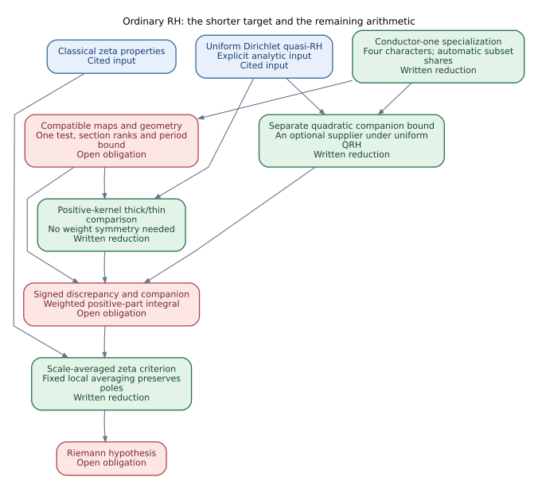

# A shorter program for ordinary RH

**The RH transfer is now proved without any weight-symmetry hypothesis.
The compatible arithmetic and geometric estimate needed to finish the proof
remains open.**

The [short guide](../paper/guide/main.pdf) explains the mathematics.
The [direct comparison](../notes/rh-direct-transfer.md) proves the preferred
RH reduction, and the [geometric refinements](../notes/rh-geometric-combination.md)
state the smaller remaining budget.

Green means a written deduction under its stated inputs. Blue means a cited
input. Red means a remaining construction or estimate. In particular, a green
transfer theorem can depend on an unresolved arithmetic construction.

## The analytic target

Only the corrected zeta prime sum must be bounded. An eventual upper bound
with exponent arbitrarily close to one half suffices; an eventual lower bound
of the opposite sign also suffices. The constants and thresholds can depend
on the exponent. The guide gives the short positivity proof.

The more flexible route needs an upper bound on arbitrarily late whole
intervals from Y to Y raised to a fixed power greater than one. For each
accuracy the multiplicative constant and interval shape are fixed before Y
varies. Only the total exponent loss must tend to zero. The analytic function
remains the zeta sum even when the auxiliary primes change.

## The preferred arithmetic comparison

The construction separates larger, or thick, weights from smaller, or thin,
weights. The full character kernel has nonnegative prime coefficients,
including at ramified primes. This permits a one-sided comparison of each
thick weight with its common lower endpoint. Averaging translations before
bounding the perturbation removes both the growing field-degree factor and
the inverse-density factor from that error.

The remaining thin samples occur at much larger prime-sum arguments.
The existing uniform quasi-Riemann hypothesis estimate controls them,
including the separately corrected principal character. The source's size
conditions make both transfer errors negligible. Thus the preferred
comparison requires no equal weight distributions, equal first moments,
logarithmic-dispersion estimate, or new bound for thick-weight logarithmic
derivatives. The large-scale thin estimate still concerns the whole character
family; it must not be omitted.

After this comparison, only four character terms remain: zeta and three
quadratic twists. Rearranging leaves one signed quadratic companion.
The manuscript's simultaneous quadratic selection bounds that companion on
the required sample interval, conditional on its stated uniform quasi-RH
input. Sample intervals must include the short endpoint shifts.

What remains is an upper bound for the **normalized averaged arithmetic
discrepancy** of the same integral maps and geometric objects. One can also
bound its sum with the signed companion directly, retaining cancellation.
This is an estimate to prove, not a completed construction.

## What the specialization removes

| Requirement in the general target | Ordinary RH |
| --- | --- |
| Reach each primitive target character | Retain only the conductor-one character. |
| Treat arbitrary target conductor and order | Both are one. |
| Compare primitive and imprimitive target functions | No target comparison is needed. |
| Impose the selected subset-share condition | This condition is automatic. |
| Project onto a general character quotient | Exactly four sign characters remain. |
| Control a growing collection of thick-weight derivative constants | Positive-kernel comparison removes them. |
| Construct a symmetric family of weights | The preferred proof has no such requirement. |

The auxiliary primes, field degrees and geometric dimensions still grow.
The source construction has not become a fixed-dimensional argument.

## The geometric budget

The new reductions keep the actual Hermitian metrics and rank weights.
Covering descent preserves the coefficient of the section-degree error,
instead of doubling it. The component estimate can use a lower weighted
mean height and an upper weighted negative-height moment; a pointwise lower
height bound is only one way to obtain those two quantities. The total
Hilbert–Samuel remainder and its excess-rank and twist costs are retained.

The refined frame estimate can be averaged before estimating its nonlinear
terms. This preserves the correlation between errors, source slope spread
and target height. Small unweighted error means are insufficient, and the
denominators associated with discarded rank and diagonal defects remain.

These improvements simplify the sufficient bounds. They do not prove the
uniform height, section-remainder or theta-frame estimates for the actual
growing family.

## Why the earlier symmetry route is optional

The source uses a common sparse set of distinguished places. Weights there
are separated from weights on its complement by a factor at least x times
the group order. Once that set is proper, exact pooled translation symmetry
is impossible, even for first moments. The proposed absolute transport
criterion is also too large for these weights. The
[source obstruction](../notes/rh-weight-symmetry.md) and
[transport analysis](../notes/transport-symmetry-defect.md) preserve the
proofs and their limits.

Conditional three-mean and complete-top projections remain valid alternatives
for a different construction. They are unnecessary for the preferred route.
Translating the top set together with the weights does not fix the issue:
the relevant character phase depends on their difference and is unchanged.

## Next mathematical work

1. Prove the weighted geometric height and section-remainder bounds for the
   actual cuspidal lattices, then carry their signed errors through the sharper
   determinant comparison.
2. Supply nonzero integral theta maps, sharp finite-prime divisibility,
   normalized global identities and archimedean estimates for those same maps.
3. Complete the remaining cohomological estimates for the growing auxiliary
   fields and bound the resulting normalized average throughout each window.

The [full proof program](full-proof-program.md) retains the general Dirichlet
target and every surviving compatibility condition. The RH case is a
substantially smaller first target, but its central arithmetic estimate is
still unproved in this reconstruction.
