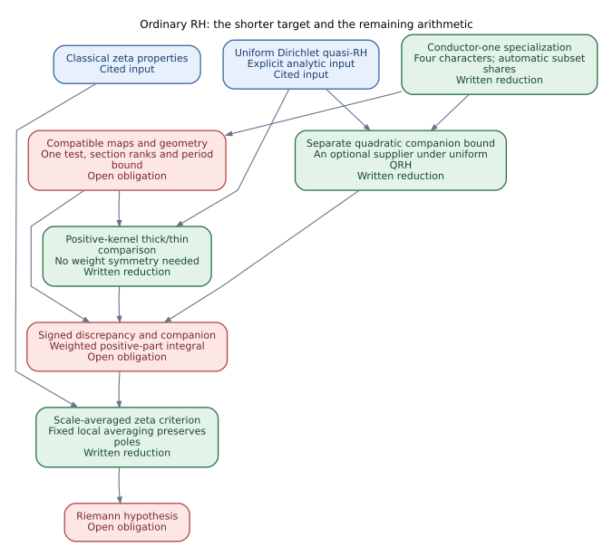

# The ordinary Riemann hypothesis

Read the [RH manuscript](../../paper/rh/main.pdf), the
[research program](program.md), and the [proof map](proof.svg).
The map is available as a scalable [SVG](proof.svg) or a [PNG image](proof.png).

## How to read the map

Read downwards from the analytic inputs and the four-character identity.
The main open task is to construct the integral maps and prove the required
height and trace bounds for those same objects. Their combined signed
estimate feeds the prime-sum criterion, which then implies RH.

Green nodes are written implications with stated hypotheses; blue nodes
are adopted cited inputs; red nodes remain open. A dashed arrow marks an
optional supplier: bounding the quadratic companion separately is one way
to prove the combined bound, but it is not an extra necessary hypothesis.
The number in the image counts written or cited nodes, not a fraction of
a completed proof. The [progress table](../progress.md) gives both RH and
GRH counts.

## Research route

The target is the corrected zeta prime sum. Four characters remain in its
arithmetic comparison, and positivity removes a proposed weight-symmetry
requirement. The final theorem permits a weighted positive-part average
over whole multiplicative intervals. The compatible geometric, integral
and trace estimates remain to be supplied.

The editable map is [map.json](map.json). Its stable nodes are counted in
[status.json](status.json) and the [progress table](../progress.md).
New shared deductions are tracked in the [shared-results index](../shared/README.md)
and reviewed for both this route and [Dirichlet GRH](../grh/README.md).

Run `python scripts/build_route_blueprints.py` to regenerate both routes,
their public compatibility views, and the completion counts. Adding a node
or moving a file is recorded separately from completing an open result.
