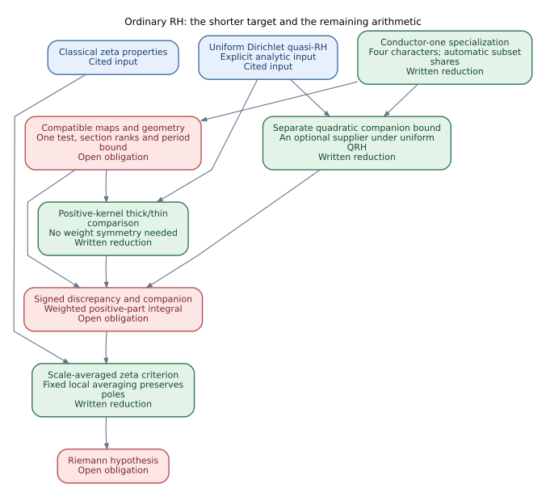

# A shorter program for ordinary RH

**The RH transfer is now proved without any weight-symmetry hypothesis.
The compatible arithmetic and geometric estimate needed to finish the proof
remains open.**

The [RH manuscript](../../paper/rh/main.pdf) presents this route separately;
the [short guide](../../paper/guide/main.pdf) explains the larger picture.
The [direct comparison](../../notes/rh-direct-transfer.md) proves the preferred
RH reduction, and the [geometric refinements](../../notes/rh-geometric-combination.md)
state the smaller remaining budget.

Green means a written deduction under its stated inputs. Blue means a cited
input. Red means a remaining construction or estimate. In particular, a green
transfer theorem can depend on an unresolved arithmetic construction.

## The analytic target

Only the corrected zeta prime sum must be bounded. An eventual upper bound
with exponent arbitrarily close to one half suffices; an eventual lower bound
of the opposite sign also suffices. The constants and thresholds can depend
on the exponent. The guide gives the short positivity proof.

The more flexible route controls a weighted positive-part integral over
arbitrarily late whole intervals from Y to Y raised to a fixed power greater
than one. The combined signed budget may first be averaged over a fixed
nearby range of scales: this logarithmic average preserves every detecting
pole. A pointwise upper bound is a stronger sufficient supplier. At each
accuracy the interval shape and averaging width are fixed before Y varies,
and the arithmetic comparison holds on the same expanded intervals. The
[fourth-power criterion](../../notes/fourth-power-sampling.md) now permits
independent finite tables of comparisons only at fourth-power arguments.
It uses convexity of the prime ramps and the known concave correction,
so its interpolation error is of square-root order for zeta. This avoids
a measurable choice of arithmetic objects over a continuum. The explicit
sampled comparisons are required; they do not follow from an almost-everywhere
bound. Only the total exponent loss must tend to zero. The analytic
function remains the zeta sum even when auxiliary primes change.

## The preferred arithmetic comparison

The construction separates larger, or thick, weights from smaller, or thin,
weights. The full character kernel has nonnegative prime coefficients,
including at ramified primes. This permits a one-sided comparison of each
thick weight with its common lower endpoint. Averaging translations before
bounding the perturbation removes both the growing field-degree factor and
the inverse-density factor from that error.

The remaining thin samples occur at much larger prime-sum arguments.
The existing uniform quasi-Riemann hypothesis estimate controls them,
including the separately corrected principal character. The source's size
conditions make both transfer errors negligible. Thus the preferred
comparison requires no equal weight distributions, equal first moments,
logarithmic-dispersion estimate, or new bound for thick-weight logarithmic
derivatives. The large-scale thin estimate still concerns the whole character
family; it must not be omitted.

After this comparison, only four character terms remain: zeta and three
quadratic twists. Rearranging leaves one signed quadratic companion.
The manuscript's simultaneous quadratic selection bounds that companion on
the required sample interval, conditional on its stated uniform quasi-RH
input. Sample intervals must include the short endpoint shifts.

What remains is the **weighted positive-part integral of the locally
averaged signed discrepancy and companion**, for the same integral maps and
geometric objects. Separate discrepancy and companion bounds are sufficient
but not necessary. The transfer and centering errors already have finite
weighted tail integrals under the stated source size conditions. The
[precise criterion](../../notes/scale-averaged-criterion.md) retains the common
windows and measurability hypotheses. Its arithmetic bound is still to prove. The finite-table alternative
requires only finitely many constructions for each interval and allows
independent choices on overlapping intervals.

## What the specialization removes

| Requirement in the general target | Ordinary RH |
| --- | --- |
| Reach each primitive target character | Retain only the conductor-one character. |
| Treat arbitrary target conductor and order | Both are one. |
| Compare primitive and imprimitive target functions | No target comparison is needed. |
| Impose the selected subset-share condition | This condition is automatic. |
| Project onto a general character quotient | Exactly four sign characters remain. |
| Control a growing collection of thick-weight derivative constants | Positive-kernel comparison removes them. |
| Construct a symmetric family of weights | The preferred proof has no such requirement. |

The auxiliary primes, field degrees and geometric dimensions still grow.
The source construction has not become a fixed-dimensional argument.

## Degree and norm bounds

The geometric comparison keeps the actual Hermitian metrics and rank
weights. The [direct component argument](../../notes/geometric-degree-frontier.md)
sums the degree-weighted volume comparison first. Short integral sections
supply a lower degree bound for the same lattices, eliminating a separate
negative-height moment. The raw version retains signed section-rank and
twist costs. The finite section estimate remains an actual requirement.

The [tower reduction](../../notes/tower-intersection-reduction.md) replaces
two scalar coefficients by one normalized Grassmannian test and a signed
determinant term. Its exact formula keeps the block contrast, rank factor
and test remainder. A [classical height theorem](../../notes/base-test-height-supplier.md)
then supplies the test from an all-point height floor, including the
boundary, and the prescribed cusp comparison. Reciprocal perturbations
and a one-sided limit suffice. The [actual point-height comparison](../../notes/actual-point-height-frontier.md)
reduces the arithmetic supplier further to one sum of degrees of the
selected small image eigensublattices. The [selected-degree identity](../../notes/selected-eigenspace-degree.md)
now gives a two-case proof retaining the favorable integral indices and
only the signed total conjugate imbalance. The exact abelian rank is kept
separate from the toric rank. A [short theta-jet proof](../../notes/theta-jet-slope-reduction.md)
reduces the tangent bound to integral theta sections and their uniform
norms, with a smaller tensor power. The
[classical theta supplier](../../notes/moret-bailly-theta-supplier.md) now
provides those inputs in the prescribed metric, giving constant 12.
The [determinant bridge](../../notes/geometric-flat-determinant.md) keeps
the exact signed signature difference and cancels the finite correction.
The integral comparison has four shorter parts:
[coefficient freeness](../../notes/boundary-hodge-freeness.md) from a
universal extension and the torus filtration,
[both filtrations](../../notes/biextension-conjugate-filtration.md) from
first-order sections and relative Frobenius,
[determinant torsion and constant finite order](../../notes/determinant-torsion-rigidity.md),
and [exact CM eigenframes](../../notes/cm-integral-eigenframes.md) from
the relative different. The local conjugate-norm calculation needs no
real generator or finite unramifiedness over the real subfield; the
global host requirements remain. Compatible formal charts along test
curves suffice for the filtration argument, including in characteristic
two; no extra global semiabelian family along the curve is required.
The [elliptic product and period calculation](../../notes/cm-product-period-calculation.md)
now supplies the integral CM product and exact signed value, including
the dyadic lattice comparison. The actual boundary charts and original
fibre pullback data, integral determinant and same-component CM lattice
identifications, cusp term and finite section estimate remain. The
[boundary period proof](../../notes/flat-family-boundary-extension.md)
constructs the generic algebraic determinant and assembles its local norms
under those precise arithmetic-model identifications. Anchoring a weight entry
does not make its sum zero or cancel its determinant contribution.

The preferred [slope comparison](../../notes/one-sided-frame-slope.md) now
uses two positive trace errors of the same maps: a source deficit and a
target excess. This permits a small amount of mass in directions with
large norms. Neither squared-energy control nor a small uniform operator
excess is intrinsic. The source slope spread, target lower slope and
positive total mass remain explicit arithmetic hypotheses. One may keep
the sharper centered source term and take the minimum with older valid
penalties; no useful regime is discarded.

For the target error, synthesis and its adjoint have the same positive
spectrum. Thus a spectral-tail bound on the full normalized block Gram
matrix suffices; its signed orbital terms are combined before taking the
positive part. The [exact periodization formula](../../notes/common-unipotent-periodization.md)
now identifies the common unipotent group and the full arithmetic sum,
with absolute convergence and the actual seed metric contract stated.
The proved trace-compression formulas carry a calibrated bound through
the actual source and target restrictions, retaining their lost mass and
dimensions. The source trace error still needs its own bound. Estimates
for an average operator alone do not bound the required correlated costs.

The [earlier energy reductions](../../notes/averaged-theta-energy.md) and
[uniform period bound](../../notes/centered-global-energy-reduction.md)
remain sufficient alternatives. Their extra error denominators are required
when those particular formulas are used; the final-space trace theorem
requires positive mass and the stated slope hypotheses instead. Counting,
divisor, initial section and quotient losses remain in the combined budget.

Four retained characters do not bound the integral splitting index: the
[frontier audit](../../notes/rh-construction-frontier.md) gives a quotient
consisting of four copies of the integers modulo the growing group order.
The [finite-symmetry analysis](../../notes/finite-symmetry-energy.md) also
retains the actual target-stability condition; positivity and total mass
alone do not control the required trace errors.

## A smaller cohomological requirement

[Classical duality and even K-groups](../../notes/qualitative-selmer-finiteness.md)
supply finiteness of the actual strict Selmer groups, including the prime
2, and finite prime support for each fixed host and twist range. This
removes separate qualitative finiteness and summability obligations. The
useful bound as the host and twists grow remains quantitative.

For RH, every auxiliary character has order a power of two, so the
[nontrivial odd-order branch](../../notes/two-primary-selmer-reduction.md)
is empty. The trivial character, complementary parity, exceptional
primes and local integral comparisons remain. Counting prime--twist
pairs jointly also improves the polynomial exponent.
The reconstructed opposite-parity estimate remains an available supplier;
its application must retain the actual group and local conditions.

The congruence consumer needs only the
[finite weighted sum on actual twisted places](../../notes/finite-twisted-place-budget.md).
Keep the ramification-inertia fractions away from generator primes;
the latter already have aggregate estimates. The support must be the
one chosen by the same arithmetic construction.

For the actual RH host, the
[residual decomposition](../../notes/rh-selmer-residual-budget.md) and
[integral projectors](../../notes/rh-selmer-product-criterion.md) leave
one weighted product of orders of finite Selmer direct factors. Its
quantitative bound remains open. The
[resultant calculation](../../notes/rh-selmer-resultant.md) supplies the
elementary integer certificate in one orbit estimate. When two such
integers bound the same orbit, a corrected greatest common divisor
replaces their product; both exceptional primes are retained. This
neither supplies the trace-to-Selmer inequality nor proves a uniform
saving for the actual integers.

The [conormal pairing](../../notes/rh-selmer-conormal-pairing.md) supplies
the lower comparison at odd primes for the same marked model: the
strict Selmer group embeds in the dual of one finite negative-weight
conormal quotient. It controls every elementary divisor and the exponent.
Ambient torsion is removed before imposing the global equations, whose
new torsion is retained. The actual models remain, with their automorphy
and rigidity inputs. The RH
specialization does not remove the five local weights or make the
cyclotomic twist self-inverse. The
[exact Euler determinant](../../notes/rh-selmer-euler-determinant.md)
keeps every generic multiplicity before the coarse upper bound.
The [finite free leading quotient and generating-function count](../../notes/rh-selmer-mixed-count.md)
give the lower numerical constant with an explicit degree threshold,
without assuming global flatness. The
[graded Koszul comparison](../../notes/rh-selmer-koszul-comparison.md)
proves positivity and exact scalar extraction; the
[four-weight argument](../../notes/rh-selmer-admissibility.md) proves
admissibility. Finally, the
[finite-slice argument](../../notes/rh-selmer-upper-multiplicity.md)
gives uniform eventual support and the generic multiplicity bound.
These complete the abstract numerical comparison under the stated
chart, spanning, finiteness, separation, tangent and trace conditions.
The one- or two-point slice also identifies the exact source of its
factor two. The [full abstract theorem](../../notes/rh-selmer-core-wrapper.md)
now supplies integral Smith normalization and the weight-zero chart cut.
An equation-valued adjustment gives a nonzero chart representative with
unchanged point values, and one orbit per degree-zero character supplies
the finite cover. The original arithmetic-model hypotheses remain. The
[arithmetic frontier](../../notes/rh-selmer-valuation-frontier.md) shows
why generic rigidity alone cannot bound the missing integral torsion,
and why the trace classes alone give no uniform common-divisor saving.

## What the pairwise norm bounds do not give

The [exact spectral examples](../../notes/redundant-period-spectrum.md)
show why the full nonidentity orbital contribution is necessarily large
in this redundant normalization. The estimate must concern its positive
tail above the mean eigenvalue. The
[integral incidence construction](../../notes/basis-invariant-trace-obstruction.md)
attains the sharp square-root loss under every invertible comparison
basis, with fixed height-zero arithmetic maps. Small arbitrary source
and target cuts preserve an explicit part of that loss. Preserve the
smaller valid energy penalty unless an actual global input improves it.
An ambient projector is not automatically the sum of the chosen periods.
The common unipotent group does give Fourier orthogonality for distinct
characters on its compact adelic quotient. The full arithmetic
periodization still contains the other rational orbits. Its exact
quotient-space isometry and a weighted Cauchy--Schwarz criterion are
proved; the required arithmetic calibration remains open.

## Why the earlier symmetry route is optional

The source uses a common sparse set of distinguished places. Weights there
are separated from weights on its complement by a factor at least x times
the group order. Once that set is proper, exact pooled translation symmetry
is impossible, even for first moments. The proposed absolute transport
criterion is also too large for these weights. The
[source obstruction](../../notes/rh-weight-symmetry.md) and
[transport analysis](../../notes/transport-symmetry-defect.md) preserve the
proofs and their limits.

Conditional three-mean and complete-top projections remain valid alternatives
for a different construction. They are unnecessary for the preferred route.
Translating the top set together with the weights does not fix the issue:
the relevant character phase depends on their difference and is unchanged.

## Next mathematical work

1. Use the supplied tangent-slope, coefficient-freeness, determinant-torsion,
   vertical-order and CM eigenframe arguments. Identify the
   [actual boundary Hodge lattice](../../notes/flat-family-finite-place-frontier.md)
   and compatible filtrations. The CM product and period value are proved;
   identify their comparison with the actual algebraic flat family and
   its prescribed local norms. The [existing level](../../notes/half-level-determinant.md)
   already gives determinant monodromy one by a direct norm argument.
   The boundary extension and local-norm assembly are proved under the
   exact arithmetic-model, integral-line and same-component CM hypotheses.
   Use the
   [selected degree comparison](../../notes/selected-eigenspace-degree.md),
   and prove the point-height comparison and the cusp/metric hypotheses
   in the [base-test supplier](../../notes/base-test-height-supplier.md), then use
   the [tower reduction](../../notes/tower-intersection-reduction.md) and
   [mean-volume supplier](../../notes/mean-volume-supplier.md).
   Equal component volumes then give the mean exactly. Supply the separate
   finite section-rank costs, using short sections to avoid a separate
   negative-height input, and carry signed errors through determinant descent.
2. Supply nonzero integral theta maps, sharp finite-prime divisibility,
   normalized global identities and the two trace estimates for those same
   maps. A signed block spectral-tail bound supplies the target estimate;
   retain the independent source estimate and the actual compression costs.
3. Bound the finite weighted Selmer product on the actual twisted primes for
   the growing auxiliary fields. Construct the marked models and verify
   their chart and geometric point conditions; the conormal pairing and
   abstract graded estimate are supplied.
   Retain the surviving character cases. Assemble signed fourth-power tables
   and bound their weighted positive parts on arbitrarily late intervals.

The [GRH program](../grh/program.md) retains the general Dirichlet
target and every surviving compatibility condition. The RH case is a
substantially smaller first target, but its central arithmetic estimate is
still unproved in this reconstruction.
